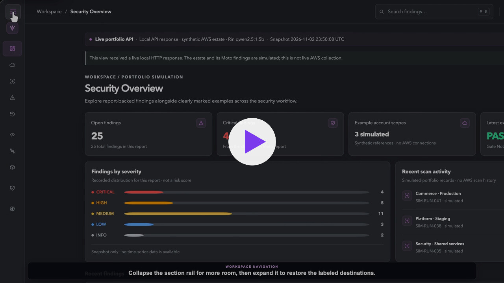
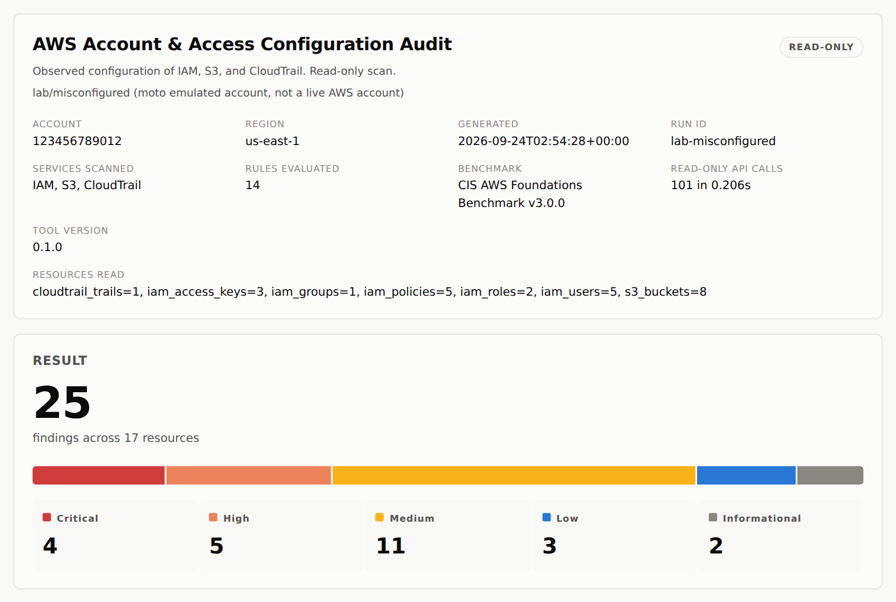
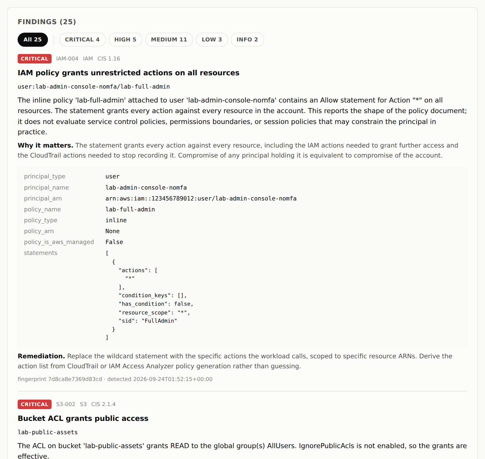
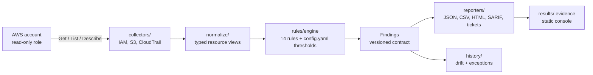
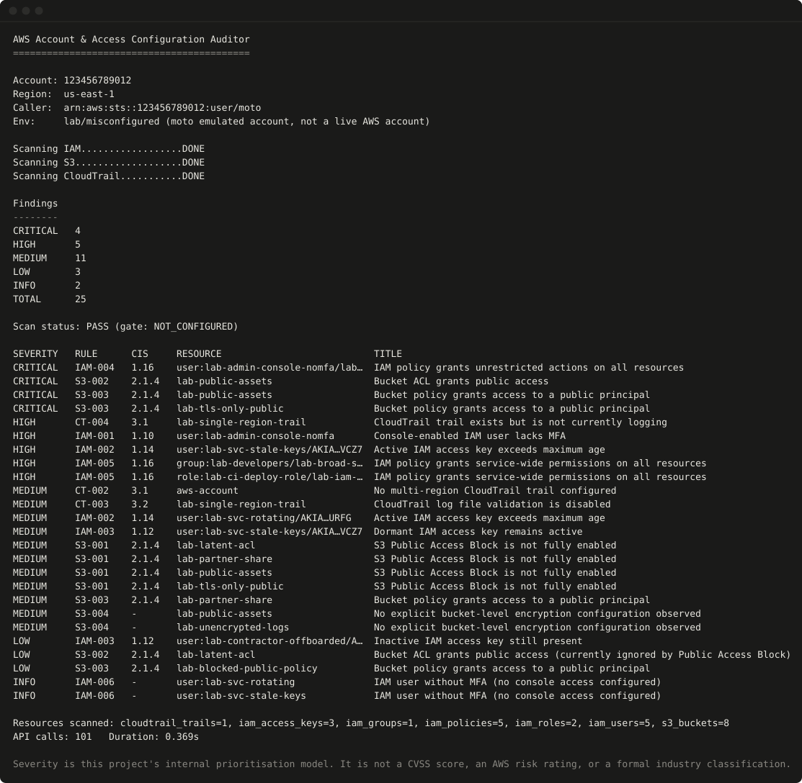

# Vorrin

[](https://github.com/tdinh-dev-sec-scientist/Vorrin/actions/workflows/ci.yml)
[](https://github.com/tdinh-dev-sec-scientist/Vorrin/actions/workflows/iac-guardrails.yml)

[](LICENSE)

**Read-only AWS security auditing with evidence reviewers can inspect.** Vorrin
checks IAM, S3, and CloudTrail configuration, then produces findings with
severity, rationale, CIS mapping, and remediation guidance. The repository also
includes IaC, Kubernetes, CI, and supply-chain security checks.

[Open the interactive console](https://tdinh-dev-sec-scientist.github.io/Vorrin/console/) ·
[Watch the scan replay](https://tdinh-dev-sec-scientist.github.io/Vorrin/) ·
[Read a sample report](https://tdinh-dev-sec-scientist.github.io/Vorrin/report.html) ·
[Inspect the JSON evidence](https://tdinh-dev-sec-scientist.github.io/Vorrin/aws_audit_results.json)

[](docs/media/vorrin-demo.mp4)

<sub>▶ Click to watch the 4-minute console walkthrough. The demo uses simulated and Moto-emulated data, not a live AWS account.</sub>

> **Demo boundary:** the public site uses saved results from an emulated Moto
> account. It does not connect to AWS, accept credentials, or run scans against
> visitors' accounts. Live AWS deployment and acceptance are not available in
> this demo.

## Why it exists

Misconfigured identities, public buckets, and missing audit logs are among the
most common root causes of cloud breaches. Commercial CSPM tools find them, but
their results are hard to verify. Vorrin is deliberately small and auditable:
every API call it makes is declared and read-only, every rule has labeled test
cases, and every number in this README links to the file that produced it.

## Try the console

No account, sign-in, or setup is required. Use this short path to explore it or
record a walkthrough:

1. Open the [interactive console](https://tdinh-dev-sec-scientist.github.io/Vorrin/console/).
2. Switch between **Misconfigured fixture** and **No CloudTrail fixture** to
   compare two saved audit scenarios.
3. Choose **Findings**, filter by severity, then open a finding to see its
   evidence, affected resource, and remediation guidance.
4. Choose **Security Scans** to compare scan execution with the security gate.
   A completed scan can still contain findings; `NOT CONFIGURED` is not a pass.
5. Open **Rin** in the lower-right corner and ask about the selected fixture.
   Answers are local and evidence-based; no model is connected.
6. Toggle light/dark mode or collapse the sidebar for the recording layout you
   prefer.

The report and JSON links in the console let you check the displayed results
against their source artifacts.

### Sample report

<picture>
  <source media="(prefers-color-scheme: dark)" srcset="docs/images/report-dark.png">
  
</picture>

<details>
<summary>More screenshots</summary>



</details>

## What is included

- **AWS audit:** read-only IAM, S3, and CloudTrail collection with 14
  deterministic checks and JSON, CSV, HTML, SARIF, and ticket reports.
- **Infrastructure and policy:** Terraform, IAM policy, Kubernetes, and
  rendered Helm scanning (Checkov and Conftest/Rego) with normalized findings
  and policy gates.
- **Delivery guardrails:** credential-free CI feedback, supply-chain
  inventory, vulnerability checks, and signed local release artifacts.
- **Review workflows:** multi-account fleet scans, drift history, expiring
  exceptions, and remediation proposals that are rescanned in a temporary
  local copy.
- **Evidence console:** a static, read-only interface for exploring saved
  findings, report details, and fixture-backed answers.

Rin is a local fixture assistant in the public demo. Optional AI integrations
are documented in the repository but are not connected to the published site.

### Security checks

| Rule | Severity | CIS v3.0.0 | Check |
| --- | --- | --- | --- |
| IAM-001 | High | 1.10 | Console-enabled IAM user lacks MFA |
| IAM-002 | High / Medium | 1.14 | Active access key exceeds maximum age |
| IAM-003 | Medium / Low | 1.12 | Dormant or disabled access key |
| IAM-004 | Critical | 1.16 | Policy grants `*` actions on `*` resources |
| IAM-005 | High / Low | 1.16 | Policy grants service-wide actions on all resources |
| IAM-006 | Info | - | IAM user without MFA (no console access) |
| S3-001 | Medium | 2.1.4 | Public Access Block not fully enabled |
| S3-002 | Critical / Low | 2.1.4 | Bucket ACL grants public access |
| S3-003 | Critical / Medium / Low | 2.1.4 | Bucket policy grants access to a public principal |
| S3-004 | Medium | - | No explicit bucket encryption configuration observed |
| CT-001 | High | 3.1 | No CloudTrail trail configured |
| CT-002 | Medium | 3.1 | No multi-region trail |
| CT-003 | Medium | 3.2 | Log file validation disabled |
| CT-004 | High | 3.1 | Trail is not delivering logs |

`python -m auditor.cli list-rules` prints this table from the rule registry.

## Architecture



- A **runtime guard** (`auditor/readonly.py`) refuses any AWS operation that is
  not in the declared read-only inventory (`auditor/permissions.py`).
- The least-privilege IAM policy in `policies/` is generated from that
  inventory, and CI fails if the two drift apart.
- Findings follow the versioned JSON schemas in `schemas/`; see
  [docs/contracts.md](docs/contracts.md).

## Run it locally

Requirements: Python 3.11 or 3.12. The fixture benchmark needs no AWS account,
credentials, or live AWS access.

```bash
python3 -m venv .venv
source .venv/bin/activate
python -m pip install -r requirements-dev.txt
python -m lab.run_benchmark
python scripts/build_site.py
python -m http.server --directory site 8000
```

Open `http://localhost:8000/console/` for the interactive console or
`http://localhost:8000/` for the scan replay. The benchmark writes its reports
under `results/`; the site is built from those generated files.

### Audit your own account

Attach `policies/auditor-readonly-policy.json` to a dedicated role or user,
then run:

```bash
python -m auditor.cli audit --profile audit-readonly --output json,html --output-dir reports --redact
```

Add `--fail-on high` to use it as a CI gate. Reports go to `reports/`, which is
gitignored because it can contain real account data.



### Docker

```bash
docker build -t vorrin .
docker run --rm -v "$PWD/reports:/out" vorrin
```

The default command audits the emulated lab account; `docker run --rm vorrin
verify` re-runs the test suite and benchmark inside the container.

## Benchmark results

These numbers come from the checked-in, labeled fixture corpus. They describe
that corpus only; they are not a real-world accuracy estimate. Refresh the
generated evidence with `python scripts/collect_metrics.py`.

<!-- BEGIN GENERATED METRICS -->

| Metric                                 |        Value | Evidence |
| -------------------------------------- | -----------: | -------- |
| Security rules                         |           14 | `results/metrics_sources.json` |
| Lab findings (misconfigured profile)   |           25 | `results/aws_audit_results.json` |
| Detection rate                         | 100% (25 TP / 0 FN / 0 FP) | `results/expected_vs_actual.json` |
| Offline fixture cases                  |           98 | `results/fixture_manifest.json` |
| Fixture cases by category              | clean=17, edge=39, malformed=8, multi=9, severity=6, vulnerable=19 | `results/fixture_manifest.json` |
| Fixture cases by service               | cloudtrail=15, iam=48, s3=35 | `results/fixture_manifest.json` |
| Tests passing                          | PASS (exact count in results/metrics.json) | `results/metrics.json` |
| Detection-code coverage                | Exact percentage in results/metrics.json | `results/metrics.json` |
| Overall package coverage               | PASS (86% CI floor) | `results/metrics.json` |
| CIS-mapped rules                       | 11/14 (v3.0.0) | `results/metrics_sources.json` |
| Self-audit of the auditor's own policy |         PASS | `results/metrics_sources.json` |
| API calls per full scan                |          101 | `results/aws_audit_results.json` |

<!-- END GENERATED METRICS -->

## Live deployment status

Phase 3 is deployed to a dedicated AWS Organizations demo account in stages.
Each stage turns on only after the previous one has reviewed acceptance
evidence in [`docs/evidence/`](docs/evidence/phase3-stage-acceptance.json);
Terraform refuses to enable it otherwise.

| Stage | Scope | Status |
| --- | --- | --- |
| 1 | Scheduled scans: EventBridge Scheduler every six hours, Step Functions, a cosign-signed Fargate scan image, a read-only cross-account role, private snapshots, drift history | Live; acceptance passed (two consecutive scheduled scans with reviewed drift) |
| 2 | Redacted results and the public read-only API | Live; acceptance passed (redaction cases, publisher-failure atomicity, API methods) |
| 3 | Invite-only console with Cognito sign-in, and Rin | Unlocked; deployment next |
| 4 | Budget cutoff, kill switch, and load tests | Waiting on Stage 3 |

Deployments run through GitHub OIDC roles pinned to protected environments,
with a permissions boundary on every role Terraform creates and an SCP that
protects the audit trail and the read-only role.

## Security and scope

- The AWS collector uses read-only operations. It does not create, update, or
  delete AWS resources.
- The public console is static and contains no AWS credentials. Fixture mode
  makes no requests to AWS or an AI provider.
- Findings describe observed configuration; they do not calculate effective
  permissions or prove exploitability.
- The public demo is hosted on GitHub Pages with HTTPS. It has no application
  server, inbound listener, or project-managed firewall.
- The Phase 3 live deployment defaults to invite-only access: Cognito sign-in
  with mandatory MFA and PKCE, an authorizer on every API method, and per-user
  Rin quotas. See [private access](docs/private-access.md).

See [SECURITY.md](SECURITY.md) to report a vulnerability and
[docs/threat-model.md](docs/threat-model.md) for the threat model.

## Development checks

```bash
python -m pytest -q
node --test tests/*.test.cjs
ruff check auditor phase3 lab tests scripts conftest.py
ruff format --check auditor phase3 lab tests scripts conftest.py
```

CI also validates the Phase 3 Terraform roots and runs the pinned IaC security
scanners. See [IaC scanning](docs/iac-scanning.md) for local scanner setup and
[CONTRIBUTING.md](CONTRIBUTING.md) for contribution rules.

## Repository map

| Path | Contents |
| --- | --- |
| `auditor/` | CLI, AWS collectors, normalizers, rules engine, and reporters |
| `auditor/iac/`, `auditor/supply_chain.py` | IaC scanning (Checkov, Conftest/Rego) and release scanning and signing |
| `auditor/fleet_scan.py`, `auditor/history.py` | Multi-account scans and local drift history |
| `phase3/` | Lambda and Fargate handlers for the scheduled, redacted live demo |
| `infra/phase3/` | Terraform for the Phase 3 AWS organization and demo accounts |
| `deploy/gatekeeper/` | OPA Gatekeeper policy for Kubernetes admission |
| `scripts/console/` | Static console, navigation, and local evidence assistant |
| `lab/`, `tests/` | Moto benchmark, labeled test cases, and regression tests |
| `schemas/`, `policies/`, `compliance/` | Versioned contracts, the generated IAM policy, and the CIS mapping |
| `docs/` | Security model, architecture decisions, operations, and tool guides |
| `results/` | Generated benchmark reports and evidence |

## Roadmap

- Raise the combined `auditor/` + `phase3/` coverage floor above 86%,
  starting with `phase3/role_capture.py` and `phase3/redaction.py`.
- Evaluate effective permissions (SCPs, permission boundaries) rather than
  policy shape alone.
- Add checks for more services, such as EC2 security groups and KMS key
  policies.
- Complete live acceptance of Phase 3 Stages 2 to 4.

## Documentation

- [Security model](docs/threat-model.md)
- [AWS permissions](docs/least-privilege.md)
- [Architecture decisions](docs/architecture/README.md)
- [IaC scanning setup](docs/iac-scanning.md)
- [Fleet scanning](docs/fleet-scanning.md)
- [Private access and user management](docs/private-access.md)
- [Operations and troubleshooting](docs/operations-runbook.md)
- [Fixture environment](docs/test-environment.md)

## License

MIT. See [LICENSE](LICENSE).
