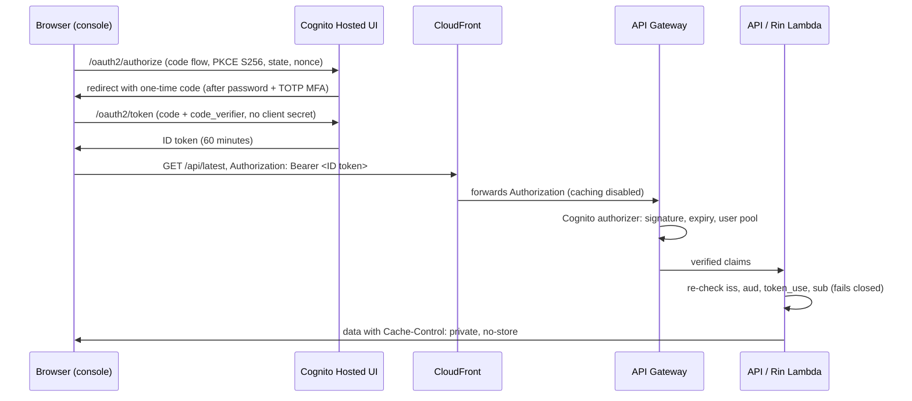

# Private access (invite-only)

Phase 3 runs in one of two access modes, set by the Terraform variable
`access_mode`:

| Mode | Who can read live data and use Rin | Traffic controls |
| --- | --- | --- |
| `invite_only` (default) | Only users the owner creates in a Cognito user pool, signed in with MFA | Cognito authorizer on every API method, API Gateway stage throttling, per-user and daily Rin quotas |
| `public` | Anyone with the URL | WAF rate limits at CloudFront and the regional API, stage throttling, per-session and daily Rin quotas |

The static console and its checked-in fixtures load in both modes. In
`invite_only` mode, live scan data and Rin appear only after sign-in.

## How a request is authorized



Security properties:

- **No self sign-up.** `allow_admin_create_user_only = true`; only the owner
  creates accounts.
- **MFA is mandatory** (TOTP). Passwords need 14+ characters with all four
  character classes. Account recovery is administrator-only, so an attacker
  who controls a user's email cannot reset the password.
- **Public PKCE client.** The console holds no client secret. `state` and
  `nonce` are checked; a forged or replayed callback never reaches the token
  endpoint. Hosted UI errors do not reveal whether an account exists.
- **Short sessions.** Only the ID token is kept, in tab-scoped session
  storage, for at most 60 minutes. No refresh token is stored.
- **Defense in depth.** The Lambdas re-check the verified claims, so a method
  accidentally left without an authorizer still returns 401. A missing or
  unknown access mode is treated as `invite_only`.
- **No shared caching.** CloudFront's `/api/*` behavior uses the managed
  CachingDisabled policy and forwards `Authorization` with the managed
  AllViewerExceptHostHeader policy. Signed-in responses are
  `Cache-Control: private, no-store` with `Vary: Authorization`.
- **Per-user quotas.** Rin's quota key is `user-<verified sub>`, so a user
  cannot reset their limit by changing the client-side session token.
- **Strict CSP.** `connect-src` allows only the console's origin and the
  Cognito Hosted UI origin, in both the CloudFront header and the page's
  meta tag.

No new IAM permissions were added for the Lambdas: authentication happens in
API Gateway, and the Lambdas only read claims from the request.

## Deploy

1. Choose a globally unique Hosted UI prefix. It must not contain `aws`,
   `amazon`, or `cognito`.
2. Set the repository variables used by the Phase 3 Terraform workflow:

   | Variable | Value |
   | --- | --- |
   | `PHASE3_ACCESS_MODE` | `invite_only` (the default when unset) |
   | `PHASE3_COGNITO_DOMAIN_PREFIX` | your prefix, for example `vorrin-console-a1b2` |

   The workflow passes the Hosted UI origin to
   `scripts/build_phase3_web.py --auth-origin`, which adds it to the console's
   CSP, and Terraform writes `auth-config.json` with the public client ID.
3. Optional variables: `enable_waf` (default off in `invite_only` mode),
   `api_throttle_rate_limit` (default 2 requests/second) and
   `api_throttle_burst_limit` (default 10), and `auth_extra_callback_urls`
   for an additional HTTPS console origin.
4. Run the workflow for the `control-plane` stack. The stage gates still apply.

## Manage users

Read the pool ID from the Terraform output `cognito_user_pool_id`, then run
these with an administrator profile in the control-plane account.

Invite a user (Cognito emails a temporary password valid for 3 days):

```bash
aws cognito-idp admin-create-user --user-pool-id "$POOL_ID" --username person@example.com --user-attributes Name=email,Value=person@example.com Name=email_verified,Value=true --desired-delivery-mediums EMAIL
```

On first sign-in the user sets a new password and enrolls an authenticator app.

List users:

```bash
aws cognito-idp list-users --user-pool-id "$POOL_ID" --query "Users[].{user:Username,status:UserStatus,enabled:Enabled}"
```

Remove access. Disable the user, then sign them out everywhere:

```bash
aws cognito-idp admin-disable-user --user-pool-id "$POOL_ID" --username person@example.com
```

```bash
aws cognito-idp admin-user-global-sign-out --user-pool-id "$POOL_ID" --username person@example.com
```

An ID token that was already issued remains valid until it expires (at most
60 minutes): API Gateway's Cognito authorizer checks signature and expiry,
not revocation. For an urgent cut-off, also turn on the static-mode kill
switch, which stops live data and Rin for everyone.

Reset a user's MFA or password (administrator-only recovery):

```bash
aws cognito-idp admin-reset-user-password --user-pool-id "$POOL_ID" --username person@example.com
```

## Verify after deployment

Record these as Stage 4 evidence; in `invite_only` mode the load/resilience
review must state `"access_mode": "invite_only"`,
`"api_throttling_engaged": true`, and
`"unauthenticated_requests_rejected": true` (see the
[access-mode amendment](phase3-access-mode-amendment.md)).

```bash
curl -s -o /dev/null -w "%{http_code}\n" "https://<console-domain>/api/latest"
```

Expect `401`. The same request with a signed-in user's ID token returns `200`
with `Cache-Control: private, no-store`. A burst beyond the stage throttle
returns `429`.

## Cost

Cognito user pools include a free allowance of monthly active users that is
far larger than an invite list; confirm the current allowance for your
feature tier on the Cognito pricing page before deploying. Turning WAF off removes two web ACLs (about $5 each
per month plus rule and request charges). Cognito advanced security is billed
per user and is not enabled; see the threat model's residual risks.
