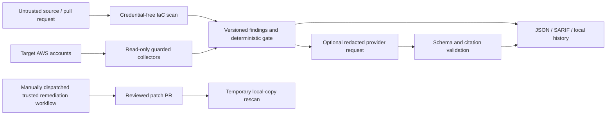

# Threat model

## Scope and security objective

This repository provides local static checks, a read-only AWS auditor, CI
feedback, a local drift store, local supply-chain artifacts, and an optional AI
sidecar. It is a single-organization tool, not a hosted multi-tenant service.
The primary security objective is to produce useful findings without giving
the scanner a path to mutate target AWS resources or letting untrusted scan
input change deterministic enforcement.

## Assets and trust boundaries

| Asset or boundary | Security treatment |
| --- | --- |
| AWS credentials and target accounts | Only `audit`, fleet scanning, and explicit Access Analyzer validation create AWS sessions. Read-only sessions install an operation allowlist; default IAM permissions contain no AWS write actions. |
| Real-AWS lab provisioning | `lab/provision` is separate from the auditor and can intentionally create vulnerable test resources only when explicitly selected with `--backend aws`, the `AUDITOR_LAB_ALLOW_REAL_AWS=yes` environment flag, and `--i-own-this-account`. It is limited to a dedicated account and is not part of ordinary tests or scans. |
| Pull-request source and scanner output | Treat as attacker-controlled. IaC subprocess environments remove AWS and CI credentials; parsers validate output and keep scanner errors non-green. Fork PRs receive no AWS credentials or OIDC role. |
| GitHub workflow tokens | The untrusted IaC scan has repository-content read only. A trusted `workflow_run` downloads SARIF data and has the separate code-scanning upload permission. The remediation workflow is manual, restricted to the default branch, and has GitHub contents/PR write scope only; it has no AWS identity. |
| Kubernetes admission | Gatekeeper runs only in a separately configured demo/authorized cluster. The auditor receives no Kubernetes credentials. The smoke script requires the named local `kind` context and uses server-side dry runs. |
| Local reports and history | Reports can contain account IDs, resource names, policies, and evidence. History directories and exports use restrictive file permissions; repositories ignore local reports. Protect backups and host access. |
| Supply-chain release key and tools | Cosign private keys stay outside the source/output tree with restrictive permissions. Tools are version-checked; Grype data must be fresh. Local signatures do not establish a public signer identity. |
| AI provider boundary | AI is explicitly invoked, receives bounded redacted context, has no tools, and cannot set the gate. Provider-side retention depends on account policy; `store: false` is not a no-retention guarantee. |

## Main threats and controls

1. **Credential leakage or accidental AWS mutation.** Runtime API allowlists,
   generated least-privilege IAM policy, repository secret scans, credential
   scrubbing in subprocesses, and tests block undeclared calls and secret
   material. The AWS boundary remains read-only, including remediation.
2. **Malicious IaC, policy text, or scanner output.** Static scans do not execute
   Terraform or apply manifests. They use pinned scanner versions, bounded
   inputs, strict JSON parsing, stable contracts, and explicit `ERROR` or
   `UNKNOWN` states. Findings cannot be silently converted into a clean result.
3. **Untrusted pull-request privilege escalation.** PR scans have no AWS
   credentials or OIDC. The remediation PR workflow uses trusted default-branch
   code and validates dispatch paths and plans before opening a review-only PR.
   Its GitHub write token cannot mutate AWS.
4. **Prompt injection, hallucinated citations, or sensitive AI output.** Model
   input is labeled untrusted and redacted. Structured output, exact finding
   matching, local citation allowlists, sensitive-output checks, no tools, and
   fail-safe provider handling prevent AI output from changing severity,
   findings, or gates. Proposals are returned only after a temporary-copy
   rescan passes.
5. **Compromised release key, stale vulnerability data, or misleading
   signatures.** The release command requires pinned scanner versions, checks
   Grype DB freshness/provenance, signs exact output bytes, and verifies before
   reporting `PASS`. The local demo skips transparency-log verification; the
   public key must be distributed through a separate trusted channel.
6. **History, exception, or report tampering.** History is local and private;
   exceptions are scoped, expiring, visible, and never delete findings. Treat
   the host and its backups as trusted administrative infrastructure.

## Residual risks and limitations

- Redaction is defense in depth, not a guarantee for arbitrary custom evidence.
  Review the data sent before enabling the optional provider, and verify the
  provider's current retention and contractual settings.
- A read-only AWS credential can still disclose account configuration. Restrict
  role trust, account scope, regions, and operator access.
- Findings describe scanned evidence, not effective IAM permissions or proof
  of exploitability. Unsupported inputs and incomplete scans remain explicit.
- Local SQLite history has no managed backup, encryption service, or multi-user
  access-control layer; secure the host and backups.
- GitHub artifacts and Actions logs are governed by repository/org retention
  policies. The workflow currently retains JSON/SARIF artifacts for 14 days.
- Local Cosign signatures lack a public transparency record and an identity-
  bound CI signer. No registry push or deployment verification is performed.
- No EventBridge/Step Functions/S3/DynamoDB deployment or AWS sandbox apply is
  included. AWS sandbox apply is not implemented or claimed; the user-approved
  [Stage 6 amendment](phase2-stage6-amendment.md) supersedes it as a Phase 2
  release blocker while preserving the read-only requirement.

## Incident response

If an AWS credential or signing key may have leaked, revoke or rotate it using
the organization's credential process, inspect the related AWS or CI audit
logs, invalidate affected release artifacts, and rebuild from a trusted
checkout. Do not treat a green scan as proof that exposed credentials were not
used.
