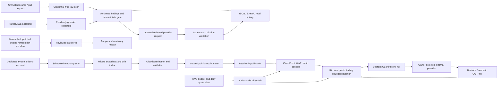

# Threat model

## Scope and security objective

This repository provides local static checks, a read-only AWS auditor, CI
feedback, local drift history, local supply-chain artifacts, an optional AI
sidecar, and code for a public Phase 3 demo that has not been deployed. It is a
single-organization tool, not a hosted multi-tenant service. The primary
security objective is to produce useful findings without giving the target
scanner a path to mutate target AWS resources or letting untrusted scan input
change deterministic enforcement.

## Assets and trust boundaries

| Asset or boundary | Security treatment |
| --- | --- |
| AWS credentials and target accounts | Only `audit`, fleet scanning, and explicit Access Analyzer validation create AWS sessions. Read-only sessions install an operation allowlist; default IAM permissions contain no AWS write actions. |
| Real-AWS lab provisioning | `lab/provision` is separate from the auditor and can intentionally create vulnerable test resources only when explicitly selected with `--backend aws`, the `AUDITOR_LAB_ALLOW_REAL_AWS=yes` environment flag, and `--i-own-this-account`. It is limited to a dedicated account and is not part of ordinary tests or scans. |
| Pull-request source and scanner output | Treat as attacker-controlled. IaC subprocess environments remove AWS and CI credentials; parsers validate output and keep scanner errors non-green. Fork PRs receive no AWS credentials or OIDC role. |
| GitHub workflow tokens | The untrusted IaC scan has repository-content read only. A trusted `workflow_run` downloads SARIF data and has the separate code-scanning upload permission. The remediation workflow is manual, restricted to the default branch, and has GitHub contents/PR write scope only; it has no AWS identity. |
| Kubernetes admission | Gatekeeper runs only in a separately configured demo/authorized cluster. The auditor receives no Kubernetes credentials. The smoke script requires the named local `kind` context and uses server-side dry runs. |
| Local reports and history | Reports can contain account IDs, resource names, policies, and evidence. History directories and exports use restrictive file permissions; repositories ignore local reports. Protect backups and host access. |
| Supply-chain release key and tools | Cosign private keys stay outside the source/output tree with restrictive permissions. Tools are version-checked; Grype data must be fresh. Local signatures do not establish a public signer identity. |
| AI provider boundary | AI is explicitly invoked, receives bounded redacted context, has no tools, and cannot set the gate. Provider-side retention depends on account policy; `store: false` is not a no-retention guarantee. |
| Phase 3 target scan | A scheduled worker assumes only the named demo-account read-only role. That role has a permissions boundary with an explicit deny outside the read allowlist, including writes granted directly to a role session by a resource policy. S3 metadata reads are restricted to buckets owned by the selected account. A separate private snapshot writer stores validated reports; the schedule is disabled by default. |
| Phase 3 publication boundary | Only the publisher bridges private snapshots to the isolated public-results store. It applies a versioned allowlist, keyed pseudonyms, sensitive-pattern rejection, and schema validation. Failure preserves the last good public snapshot. |
| Phase 3 public API and Rin | The API reads sanitized scan results and its feature flag, and writes its own logs. Rin reads sanitized scan results, its feature flag and provider secret, writes its own logs, and invokes only the separate quota function. When enabled, its role can call `bedrock:ApplyGuardrail` on one exact owner-managed Guardrail ARN; it cannot invoke a Bedrock model. Input and validated output are checked before the external provider response reaches the visitor. Rin is disabled until its provider, published Guardrail, rates, quotas, and budgets are configured. |
| Phase 3 kill switch and cost | AWS Budgets can disable Rin and mark the console static. A separate quota-limit metric alerts without message or session data. Budget notifications may be delayed and do not cap accrued charges. |

## Main threats and controls

1. **Credential leakage or accidental AWS mutation.** Runtime API allowlists,
   generated least-privilege IAM policy, repository secret scans, credential
   scrubbing in subprocesses, and tests block undeclared calls and secret
   material. Target scans, the public API, and Rin remain read-only. Separate
   Phase 3 Terraform, snapshot, publisher, quota, and kill-switch writes are
   scoped to their named resources.
2. **Malicious IaC, policy text, or scanner output.** Static scans do not execute
   Terraform or apply manifests. They use pinned scanner versions, bounded
   inputs, strict JSON parsing, stable contracts, and explicit `ERROR` or
   `UNKNOWN` states. Findings cannot be silently converted into a clean result.
3. **Untrusted pull-request privilege escalation.** PR scans have no AWS
   credentials or OIDC. The remediation PR workflow uses trusted default-branch
   code and validates dispatch paths and plans before opening a review-only PR.
   Its GitHub write token cannot mutate AWS.
4. **Prompt injection, off-topic requests, or sensitive AI output.** Model
   input is treated as untrusted and redacted. The owner-managed Bedrock
   Guardrail checks the bounded input and validated answer for prompt attacks,
   denied topics, and sensitive data; any intervention or error selects the
   fixture fallback. Structured output, exact finding matching, local citation
   allowlists, sensitive-output checks, and no tools prevent AI output from
   changing severity, findings, or gates. The deployed Guardrail configuration
   and adversarial evaluation remain live acceptance evidence.
5. **Compromised release key, stale vulnerability data, or misleading
   signatures.** The release command requires pinned scanner versions, checks
   Grype DB freshness/provenance, signs exact output bytes, and verifies before
   reporting `PASS`. The local demo skips transparency-log verification; the
   public key must be distributed through a separate trusted channel.
6. **History, exception, or report tampering.** History is local and private;
   exceptions are scoped, expiring, visible, and never delete findings. Treat
   the host and its backups as trusted administrative infrastructure.
7. **Public data leakage or unsafe publication.** Public users cannot read the
   private snapshot store. The publisher is the only data bridge and rejects
   unknown or sensitive values before updating the last-good pointer. The
   public contract includes only a schema-checked summary of bounded numeric
   and boolean facts; raw evidence blobs remain private. The API and Rin cannot
   publish or access target-account data directly.
8. **Anonymous traffic or provider-cost abuse.** WAF rate limits requests,
   session and daily quotas are atomic, question/input/output sizes are
   bounded, and the provider secret is fetched only after a fresh kill-switch
   check and an input Guardrail pass. Two Guardrail evaluations per live
   request are included in the AWS cost estimate. Static fallback keeps scan
   results available when Rin is paused.

## Residual risks and limitations

- Redaction is defense in depth, not a guarantee for arbitrary custom evidence.
  Review the data sent before enabling the optional provider, and verify the
  provider's current retention and contractual settings.
- The code calls a configured Bedrock Guardrail, but this repository does not
  create or verify its policies. The owner must publish and test the exact
  prompt-attack, denied-topic, and sensitive-information configuration and
  review invocation logging before enabling Rin.
- A read-only AWS credential can still disclose account configuration. Restrict
  role trust, account scope, regions, and operator access.
- Findings describe scanned evidence, not effective IAM permissions or proof
  of exploitability. Unsupported inputs and incomplete scans remain explicit.
- Local SQLite history has no managed backup, encryption service, or multi-user
  access-control layer; secure the host and backups.
- GitHub artifacts and Actions logs are governed by repository/org retention
  policies. The workflow currently retains JSON/SARIF artifacts for 14 days.
- Local Cosign signatures lack a public transparency record and an identity-
  bound CI signer. No registry push or deployment verification is performed.
- Phase 3 EventBridge, Step Functions, S3, DynamoDB, API Gateway, CloudFront,
  WAF, budget, and kill-switch resources exist as Terraform code but have not
  been deployed or accepted. Live scans, public exposure, external TLS/header
  checks, load tests, and actual cost records remain unverified.
- AWS sandbox apply for Phase 2 remediation is not implemented or claimed; the
  user-approved [Stage 6 amendment](phase2-stage6-amendment.md) preserves that
  Phase 2 deviation and does not widen the Phase 3 scanner's permissions.

## Incident response

If an AWS credential or signing key may have leaked, revoke or rotate it using
the organization's credential process, inspect the related AWS or CI audit
logs, invalidate affected release artifacts, and rebuild from a trusted
checkout. Do not treat a green scan as proof that exposed credentials were not
used.
